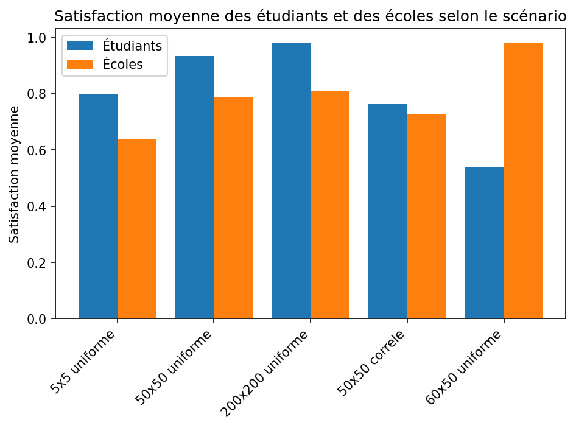

# Projet Aide à la décision — Mariage stable

Affectation d'étudiants à des établissements avec l'algorithme de **Gale-Shapley**
(acceptation différée), puis évaluation de la stabilité et de la satisfaction des
deux côtés sur des jeux de préférences générés aléatoirement.

Consigne : chaque établissement a **une seule place** (capacité = 1). Par défaut il y a
autant d'établissements que d'étudiants (mariage stable classique 1-1). L'algorithme
fonctionne aussi avec des capacités > 1.

## Structure du projet

| Fichier | Rôle |
|---|---|
| `generateur_preferences.py` | Génère les préférences aléatoires (modes `uniforme` et `correle`), vérifie, sauvegarde et charge les jeux de données JSON. |
| `mariage_stable.py` | Algorithme de Gale-Shapley (étudiants proposants), test de stabilité (`est_stable`) et rang obtenu par chaque étudiant (`rang_obtenu`). |
| `bilan_mariage_stable.py` | Lance l'algorithme sur tous les jeux de `jeux_de_donnees/` et affiche un tableau récapitulatif. |
| `satisfaction.py` | Mesures de satisfaction des étudiants et des écoles (score normalisé entre 0 et 1). |
| `tests.py` | Compare la satisfaction sur plusieurs scénarios (moyenne sur 20 seeds) et produit `satisfaction_scenarios.png`. |
| `test_rapide.py` | Test de bout en bout : Gale-Shapley côté étudiants **et** côté établissements, stabilité et satisfaction. |
| `jeux_de_donnees/` | 22 jeux de test JSON (exemple du cours + 7 scénarios × 3 seeds). |

## Prérequis

- Python 3.8+
- `matplotlib` (uniquement pour `tests.py`)

```bash
pip install matplotlib
```

## Utilisation

```bash
# (Re)générer tous les jeux de données dans jeux_de_donnees/
python3 generateur_preferences.py

# Mariage stable sur un jeu aléatoire de 5x5 (seed 42) ou sur un fichier précis
python3 mariage_stable.py
python3 mariage_stable.py jeux_de_donnees/exemple_cours.json

# Tableau bilan sur tous les jeux de données
python3 bilan_mariage_stable.py

# Comparaison étudiants proposants / établissements proposants
python3 test_rapide.py
python3 test_rapide.py jeux_de_donnees/moyen_uniforme_50x50_seed1.json

# Satisfaction par scénario + graphique
python3 tests.py
```

Utilisation depuis un autre fichier :

```python
from generateur_preferences import generer, charger
from mariage_stable import mariage_stable, est_stable, rang_obtenu

data = generer(10, mode="uniforme", seed=42)   # 10 étudiants, 10 établissements
aff = mariage_stable(data)                     # {"e0": "s3", "e1": None, ...}
stable, paire_bloquante = est_stable(data, aff)
```

## Format des données

```json
{
  "parametres":     {"n": 5, "m": 5, "mode": "uniforme", "seed": 1, "places": 5, "bruit": null},
  "etudiants":      {"e0": ["s2", "s0", "..."]},
  "etablissements": {"s0": ["e3", "e1", "..."]},
  "capacites":      {"s0": 1, "s1": 1}
}
```

- `etudiants` : vœux de chaque étudiant, du préféré au moins aimé.
- `etablissements` : priorités de chaque établissement, du préféré au moins aimé.
- `capacites` : nombre de places par établissement (1 selon la consigne).

## Génération des préférences

- **`uniforme`** : chaque agent classe l'autre côté selon une permutation aléatoire.
- **`correle`** : chaque établissement a une popularité et chaque étudiant un niveau ;
  chaque agent classe selon `score_commun + bruit_individuel`.
  Bruit petit → goûts très similaires → forte concurrence ; bruit grand → proche de l'uniforme.

Même `seed` ⇒ même jeu de données (reproductible).

Scénarios générés (seeds 1, 2, 3) :

| Scénario | Étudiants × Établissements | Mode | Bruit |
|---|---|---|---|
| `petit_uniforme` | 5 × 5 | uniforme | – |
| `moyen_uniforme` | 50 × 50 | uniforme | – |
| `grand_uniforme` | 200 × 200 | uniforme | – |
| `moyen_correle_fort` | 50 × 50 | corrélé | 0.1 |
| `moyen_correle_faible` | 50 × 50 | corrélé | 1.0 |
| `grand_correle` | 200 × 200 | corrélé | 0.3 |
| `moyen_desequilibre` | 60 × 50 | uniforme | – |

## Algorithme

Gale-Shapley, **étudiants proposants** :

1. Tous les étudiants sont libres.
2. Un étudiant libre candidate à son meilleur vœu pas encore essayé.
3. Si l'établissement dépasse sa capacité, il rejette l'étudiant le moins bien classé,
   qui redevient libre.
4. On recommence jusqu'à ce que plus aucun étudiant libre ne puisse candidater.

Le résultat est **stable** : il n'existe aucune paire bloquante (un étudiant et un
établissement qui se préféreraient mutuellement à leur affectation actuelle).
`est_stable` vérifie cette propriété et renvoie la paire bloquante si elle existe.

## Mesure de la satisfaction

Chaque rang obtenu est converti en note entre 0 et 1 :

```
score = 1 - (rang - 1) / (n - 1)
```

1 = premier choix, 0 = dernier choix (ou non affecté). Pour une école, la note est la
moyenne des scores de ses admis (0 si elle n'a personne).

## Résultats

Tous les jeux de données donnent une affectation **stable** (`bilan_mariage_stable.py`).

Satisfaction moyenne sur 20 seeds (`tests.py`) :

| Scénario | Étudiants | Écoles | Non affectés |
|---|---|---|---|
| 5×5 uniforme | 0.800 | 0.638 | 0 |
| 50×50 uniforme | 0.934 | 0.789 | 0 |
| 200×200 uniforme | 0.980 | 0.809 | 0 |
| 50×50 corrélé | 0.762 | 0.729 | 0 |
| 60×50 uniforme | 0.539 | 0.981 | 10 |



Observations :

- Les étudiants proposent, donc l'affectation leur est favorable : leur satisfaction
  est plus élevée que celle des écoles quand le marché est équilibré.
- Quand les préférences sont corrélées (tout le monde veut les mêmes écoles), la
  concurrence augmente et la satisfaction des étudiants baisse.
- Avec plus d'étudiants que de places (60×50), 10 étudiants restent sans place et
  l'avantage passe du côté des écoles, qui remplissent toutes leurs places avec de
  bons candidats.
